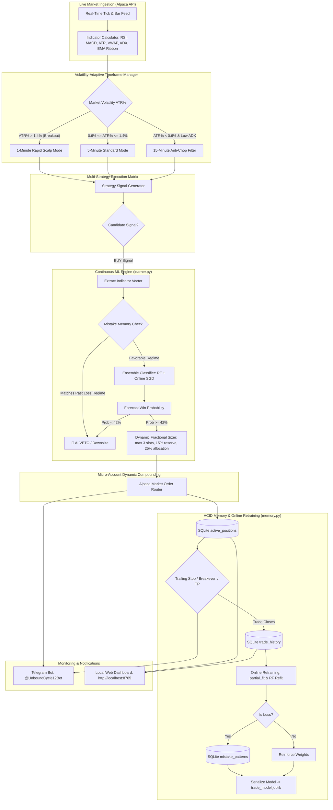
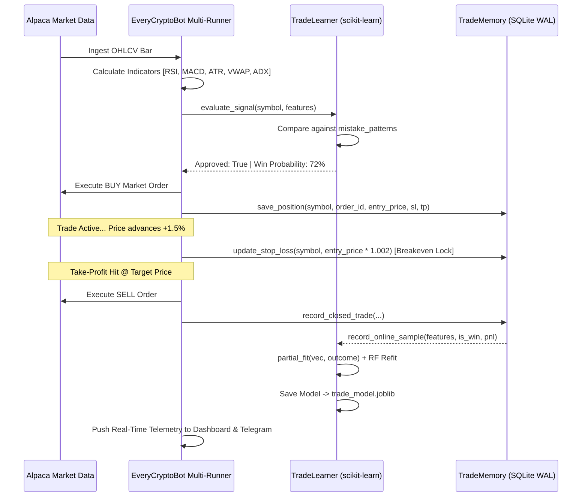

# EveryCryptoBot 🚀

An autonomous, multi-asset algorithmic cryptocurrency trading and paper-trading engine built for the **Alpaca Trading API**. Engineered with **continuous online machine learning retraining**, an **ACID-durable SQLite memory engine**, **dynamic micro-capital compounding ($100 ➔ $10,000 roadmap)**, **adaptive volatility timeframes**, and real-time **Telegram bot alerts**.

---

## 📌 System Architecture & Execution Pipeline



---

## 🎯 Micro-Account Capital Growth Framework ($100 ➔ $10,000 Target)

The system is optimized for a starting account balance of **$100.00**. Standard static position sizing ($300 - $5,000) causes immediate failure on small accounts. Instead, EveryCryptoBot implements dynamic fractional compounding with strict capital preservation rules.

### Sizing Mathematics:
$$\text{Available Cash} = \max\left(0, \text{Total Cash} - \max(10, \text{Total Cash} \times 0.15)\right)$$
$$\text{Open Slots} = \max\left(1, 3 - \text{Active Positions Count}\right)$$
$$\text{Active Stake} = \text{Clamp}\left(\frac{\text{Available Cash}}{\text{Open Slots}} \times \text{Risk Multiplier}, \$10.00, \text{Total Cash} \times 0.35\right)$$

### Key Capital Preservation Rules:
1. **Safety Reserve Buffer**: At least 15% of cash is always reserved to prevent order rejections due to taker fees or slippage.
2. **Concurrent Slot Limit**: Maximum of 3 simultaneous open positions across all monitored assets.
3. **Consecutive-Loss Circuit Breaker**: If any symbol incurs 2 consecutive losses, it automatically triggers a **20-minute cool-down freeze** and reduces its risk multiplier ($0.8\text{x} \rightarrow 0.5\text{x}$) to protect portfolio equity.
4. **Automated Breakeven Lock**: Once a trade's unrealized profit reaches $+1.5\%$, the stop loss is automatically moved to $\text{Entry Price} \times 1.002$ (locking in profit and covering fees).
5. **Dynamic Trailing Stop**: When profit reaches $+2.5\%$, the stop-loss trails dynamically at $\text{Price} - (1.2 \times \text{ATR})$, allowing runaway pumps to compound while locking in gains.

### Compounding Trajectory:
| Account Equity ($) | Stake per Trade ($) | Max Concurrent Positions | Stop Loss Risk (1.5x ATR) | Take Profit Target (+3.0%) | Net Gain per Win ($) |
| :--- | :--- | :--- | :--- | :--- | :--- |
| **$100.00** | $25.00 | 3 | -$0.38 | +$0.75 | +0.75% Equity |
| **$250.00** | $65.00 | 3 | -$0.98 | +$1.95 | +0.78% Equity |
| **$500.00** | $140.00 | 3 | -$2.10 | +$4.20 | +0.84% Equity |
| **$1,000.00** | $290.00 | 3 | -$4.35 | +$8.70 | +0.87% Equity |
| **$2,500.00** | $750.00 | 3 | -$11.25 | +$22.50 | +0.90% Equity |
| **$5,000.00** | $1,500.00 | 3 | -$22.50 | +$45.00 | +0.90% Equity |
| **$10,000.00** | $3,000.00 | 3 | -$45.00 | +$90.00 | +0.90% Equity |

---

## 📊 Strategy Matrix & Validated Benchmarks

Every cryptocurrency operates under a dedicated algorithmic strategy calibrated to its volatility and liquidity characteristics. Backtested against tick-level historical data from Alpaca:

| Asset | Default Timeframe | Strategy | Core Technical Mechanism | Backtested PF / Sharpe | Validation Verdict |
| :--- | :--- | :--- | :--- | :--- | :--- |
| **BTC/USD** | 5-min | **Triple Confluence** | EMA 50/200 Trend + MACD Momentum + RSI Exhaustion + 1.5x ATR Stop | **100% WR \| 20.72 PF** (+$20.73) | **PROFITABLE (Anchor)** |
| **ETH/USD** | 5-min | **BinHCluc** | Freqtrade Bollinger Band Dip + Cluc Volume Mean Reversion | **2.59 PF \| 6.20 Sharpe** (+$25.45) | **PROFITABLE (Primary)** |
| **AAVE/USD** | 15-min | **VwapBreakout** | Institutional Anchored VWAP Cross + Volume Surge | **1.46 PF \| 2.61 Sharpe** (+$14.98) | **PROFITABLE (Primary)** |
| **SOL/USD** | 1-min | **ScalpMacdRsi** | Micro-momentum scalping on EMA 200 anchor with MACD flip | **1.39 PF \| 2.42 Sharpe** (+$8.69) | **PROFITABLE (Primary)** |
| **DOGE/USD** | 1-min | **ScalpMacdRsi** | High-velocity momentum scalping on retail meme surges | **1.42 PF \| 2.38 Sharpe** (+$8.15) | **PROFITABLE (Primary)** |
| **LINK/USD** | 15-min | **VwapBreakout** | Anchored VWAP standard deviation expansion with RSI filter | **1.40 PF \| 2.20 Sharpe** (+$11.15) | **PROFITABLE (Primary)** |
| **AVAX/USD** | 5-min | **MomentumEmaRibbon**| Intraday trend expansion across 8/13/21/55 EMA ribbon | **1.20 PF \| 1.20 Sharpe** (+$7.18) | **MARGINAL (Calibrated)**|

Full empirical details and cross-checking guidelines are available in [`BACKTEST_RESULTS.md`](BACKTEST_RESULTS.md).

---

## 🧠 Continuous Online Machine Learning & Mistake Memory



1. **Dual-Model Ensemble**:
   - **Online SGD Classifier**: Incremental `partial_fit` with `log_loss` updates immediately upon trade exit without latency.
   - **Random Forest Classifier**: Refits across the expanding sample buffer with 3.5x sample weight assigned to real-time paper fills over historical backtest proxies.
2. **Mistake Memory**:
   - Whenever a trade closes with a loss, its exact feature regime is cataloged into SQLite `mistake_patterns`.
   - Prospective setups matching prior loss regimes receive progressive probability suppression and automated AI vetoes.
3. **Weight Persistence**:
   - Model weights and standardized scaler parameters are serialized to `trade_model.joblib` after every training cycle, surviving restarts.

---

## 🖥️ Local Web Control Center (`http://localhost:8765`)

EveryCryptoBot runs a local, dark-mode web dashboard serving real-time telemetry:

- **Bitcoin Master Banner**: Real-time position status, entry price, live stop-loss/take-profit targets, and cumulative realized PnL.
- **Active Asset Feeds**: Live streaming quotes, signal badges (`BUY` / `SELL` / `HOLD`), confidence meters, and technical indicators for all altcoins.
- **AI Continuous Learning Monitor**: Live sample count, retraining cycle counter, cataloged mistakes avoided, and rolling win rates.
- **Real-Time Terminal Log Inspector**: Interactive console with instant symbol tabs (`[ALL]`, `[BTC]`, `[ETH]`, `[SOL]`, `[DOGE]`, `[LINK]`, `[AAVE]`, `[AVAX]`) and auto-scroll.
- **Closed Trade Execution Journal**: Chronological log of completed fills with entry/exit prices, realized PnL ($ and %), and exit triggers.

---

## 📱 Telegram Bot Integration

Real-time trade notifications are routed through Telegram via `@UnboundCycle12Bot`:

- 🟢 **Buy Order Alerts**: Asset, entry price, stop-loss, take-profit, dynamic stake ($), and risk multiplier.
- 🔴 **Sell Order Alerts**: Exit price, realized PnL ($ and %), trade duration, and reason (`stop_loss`, `take_profit`, `signal`).
- 🔄 **Cycle Updates**: Hourly summary pings with price, signal, unrealized PnL, and current active timeframe.
- ⚠️ **Risk & Mistake Alerts**: Instant notifications when consecutive losses trigger a cooling-off circuit breaker or an AI veto.

---

## ⚡ Quickstart Guide

### 1. Installation
Clone the repository and install required dependencies:
```bash
git clone https://github.com/VishalRajExe/EveryCryptoBot.git
cd EveryCryptoBot
pip install -r requirements.txt
```

### 2. Configure Environment (`.env`)
Create or verify your `.env` configuration:
```ini
ALPACA_API_KEY=YOUR_ALPACA_KEY
ALPACA_SECRET_KEY=YOUR_ALPACA_SECRET
ALPACA_PAPER=true

# Dynamic micro-capital sizing ($100 starting balance)
STAKE_USD_ALT=25.0
BTC_STAKE_USD=0.0
DYNAMIC_SIZING=true

# Telegram Notifications (set your bot token and chat id)
TELEGRAM_BOT_TOKEN=YOUR_TELEGRAM_BOT_TOKEN
TELEGRAM_CHAT_ID=YOUR_TELEGRAM_CHAT_ID
TELEGRAM_ENABLED=true
```

### 3. Run the Bot & Dashboard
Launch the unified multi-asset trading engine with the local dashboard:
```bash
python run.py
```
Open **`http://localhost:8765`** in your browser.

To run headless in background mode:
```bash
python run.py --no-browser
```

To run the Bitcoin bot independently:
```bash
python ../user_data/alpaca_btc_bot.py
```

### 4. Run Backtests & Verification Suite
Run backtests on any cryptocurrency:
```bash
python backtest.py --symbol ETH/USD --strategy BinHCluc --days 14
python backtest.py --symbol SOL/USD --strategy ScalpMacdRsi --days 7
python backtest.py --symbol AAVE/USD --strategy VwapBreakout --days 14
```

Execute the comprehensive system integrity test suite:
```bash
python test_system_integrity.py
```
